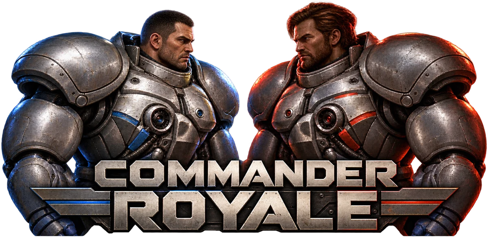
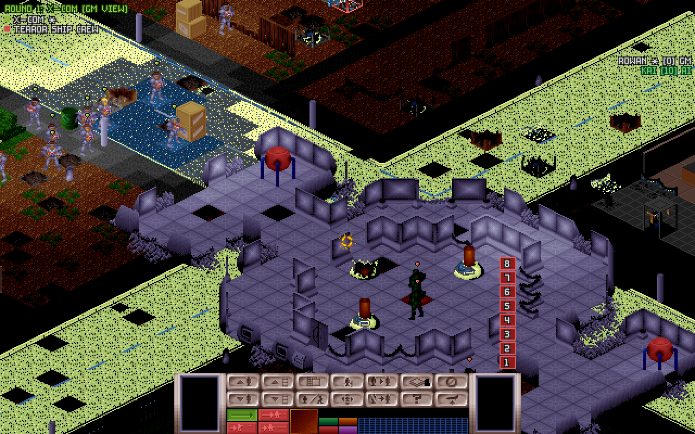
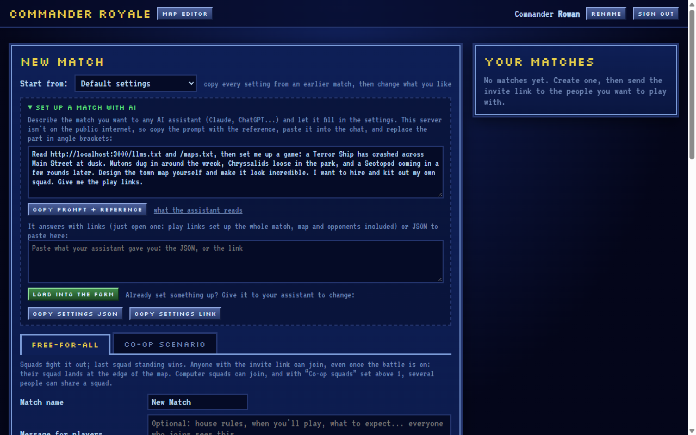
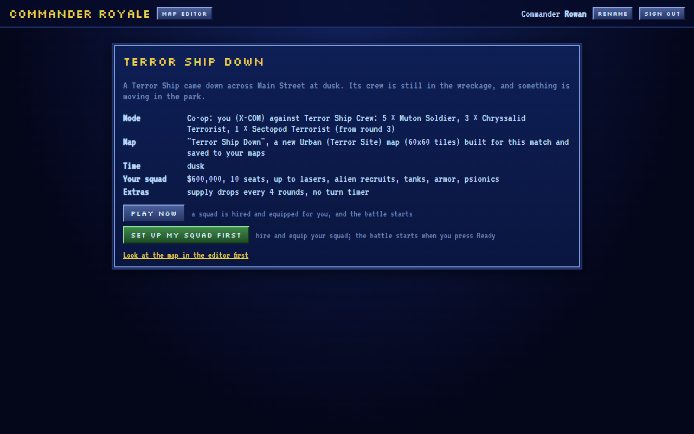
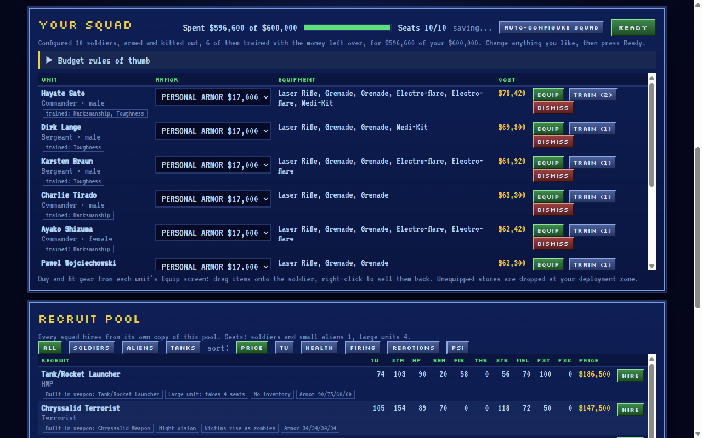
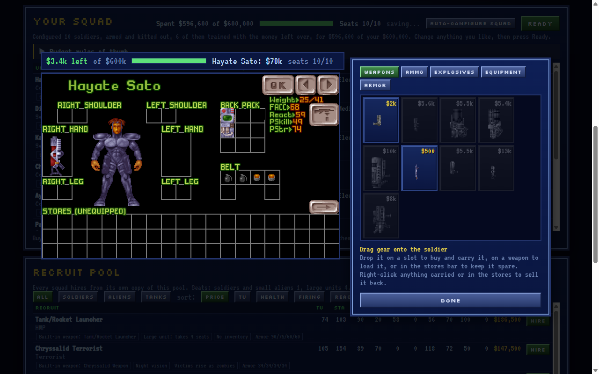
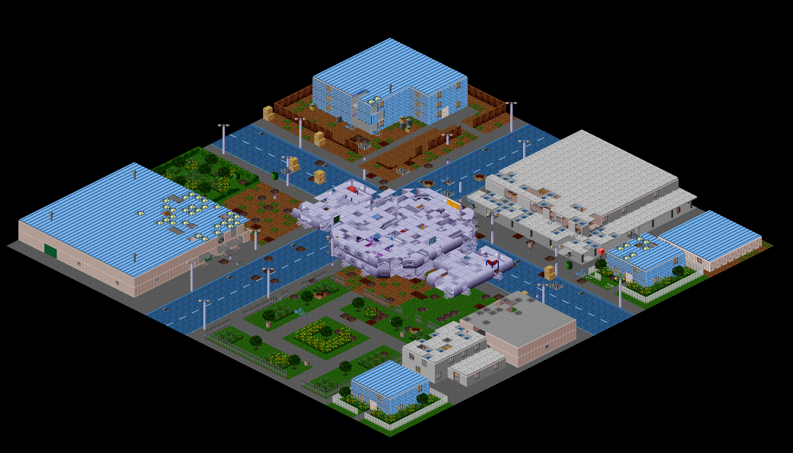
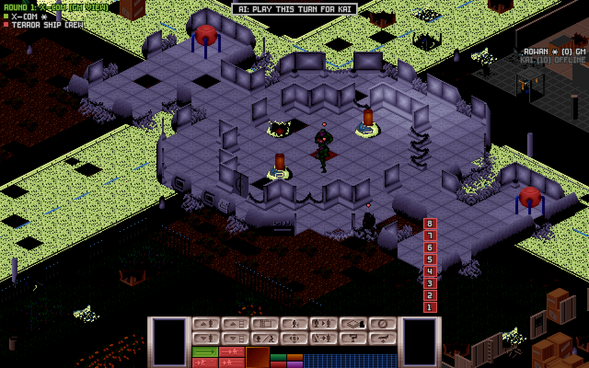

<p align="center"></p>

> [!TIP]
> A coding agent working in this repo can do most of the setup. For example, ask it:
>
> - *"Clone this and get it running locally. My copy of X-COM: UFO Defense is in `C:\GOG Games\XCOM`."*
> - *"Set this up so my friends on our home Wi-Fi can play."*
> - *"Host it on my tailnet with Tailscale Serve, so everyone's signed in as their Tailscale identity."*
> - *"Put it on my VPS at game.example.com behind Caddy, with a password for each of my five friends."*
> - *"Write an access plugin that only lets in people with an invite code I hand out."*
> - *"Set up a co-op match: four of us against Chryssalids in a city at night, reinforcements on round 3."*
> - *"Make me a map: a ruined Mars outpost round a crashed supply ship, with cover for 4 squads."*
> - *"Run a bot tournament and tell me which squad strategy wins most at a $400,000 budget."*
>
> [`AGENTS.md`](AGENTS.md) has the instructions agents (Claude Code, Codex, Cursor...) need for these. A chat
> assistant can also set up matches and design maps through the game itself: see
> [Setting up a match with an AI assistant](#setting-up-a-match-with-an-ai-assistant).

# Commander Royale

A browser remake of the X-COM: UFO Defense battlescape, rebuilt for multiplayer: free-for-all squad battles and
co-op scenarios (a team of people against an enemy a game master sets up), which anyone with the invite link can
join, even mid-battle. It uses the original game's graphics, maps, terrain and sounds (loaded from your own copy of
the game) and the original rules (time units, accuracy, reaction fire, voxel line of fire, destructible terrain, fire,
smoke, night lighting, psionics...), with a multiplayer layer on top: lobbies with invite links, a shared recruit
pool priced by ability, a budget-based armory, training, computer squads, supply drops, retries and shareable
challenges.

Commander Royale is a fan project, not affiliated with the owners of X-COM. It ships none of the original game's
files: you need your own copy of X-COM: UFO Defense (GOG or Steam).

### Screenshots

<p align="center"></p>

These follow one match from the request to the battle. The player asked an AI assistant for a co-op mission: a
Terror Ship crashed across a town's main street at dusk, Mutons around the wreck, Chryssalids in the park, and a
Sectopod arriving a few rounds later, on a map the assistant would design.



The assistant answered with two links to the same setup. One auto-configures a squad and starts the battle; the
other, used here, lets the player hire and equip their own squad first. The link opens this page, and nothing is
created until the player presses a button.



The squad, hired from the match's recruit pool with Auto-configure and then adjustable unit by unit. The pool
includes aliens and tanks when the match allows them. Equipment is bought and fitted on the original inventory
screen.




The map the assistant designed: original city blocks with the Terror Ship placed across the crossroads and the
buildings around it damaged ([recipe](docs/terror-ship-down.recipe.json)). Below it, the wreck in the battlescape,
seen by a game master who is watching rather than playing.




## Running it

Requirements: [Bun](https://bun.sh) 1.3+ and an X-COM: UFO Defense install.

```sh
bun install
# copy the game data folders into ./gamedata (or point GAME_DIR at your install)
cp -r "<X-COM install>/"{GEODATA,GEOGRAPH,MAPS,ROUTES,SOUND,TERRAIN,UFOGRAPH,UNITS} gamedata/
bun tools/render-music.ts   # optional: renders the General MIDI battle music to gamedata/MUSIC (needs ffmpeg)
bun run dev                 # builds the client and starts http://localhost:3000
```

Open `http://localhost:3000`, type a commander name, and create a match. To try multiplayer on your own, open a
second browser profile or a private window and sign in under another name.

Browsers can't play MIDI, so `render-music.ts` synthesizes the original battle tracks (GMTACTIC, GMENBASE,
GMMARS, GMWIN, GMLOSE) once with spessasynth_core and the GeneralUser GS soundfont (downloaded to
`tools/.cache` on first run) and encodes them as Ogg Opus. They're served like the other game files. Music and
sound effects can each be switched off, and their volumes set, from the battlescape's Options screen.

## Hosting for your friends

The game has no opinion about who may play: out of the box people just type a name, which suits a LAN or a
tailnet. For anything else, put an authenticating proxy in front (`AUTH=header`) or load an access plugin
(`PLUGINS=...`: a shared passkey, an allow-list, Google sign-in, or your own). [examples/](examples/README.md)
covers the common setups (LAN, Tailscale with or without Tailscale Serve identities, Caddy with a password per
player, Cloudflare Tunnel + Access, oauth2-proxy, Google sign-in) and lists every setting.

## How a match works

1. **Create a match**: environment (urban, farmland, forest, jungle, desert, mountains,
   polar, Mars, alien base), time of day, optional landed UFO, map size (auto: sized when the battle starts for the
   squads there and the budget; or pick one), budget, seat limit, recruit pool size, technology level,
   alien recruits / tanks / armor / psionics toggles, supply drops (frequency, warning time, loot table, kits per drop), the
   Mysterious Stranger's chance and an optional turn timer. The form shows what the budget buys (example squads priced from the real catalog).
2. **Invite**: share the match link. Anyone who opens it signs in and joins the lobby; there's no player
   limit (a battle takes up to 30 sides). The creator
   can also add computer squads ("Add AI squad", with a hiring strategy); they hire automatically, are always
   ready, and play their turns on the server one action at a time so you can watch. Each computer squad has
   AI settings: aggression (cautious to reckless), how keen it is on explosives, how many rounds it remembers
   where it saw an enemy, the round after which it knows where everyone is, whether each race plays to type, and
   a strength (25–400% of the budget and seats), for example a double-strength alien squad against a team of
   people.
3. **Loadout**: every player hires from an identical copy of a randomly generated pool of rookies up to veteran
   commanders, every alien race and rank, and tanks. Prices follow ability (time units, health × armor, accuracy,
   reactions, strength, psionics, innate weapons, flight, night vision, special abilities). Buy weapons, ammo,
   explosives, equipment and armor, then kit out each unit on the original inventory screen. Unequipped gear is
   dropped at your deployment zone. Human soldiers can also be put through training (Marksmanship, Reflexes,
   Fitness, Toughness, Grenadier, Close combat and, with psionics, Psi training; up to 4 sessions each, never past
   the original stat caps). A session costs $10,000 or 12.5× what the price model says the better stats are worth,
   whichever is more, so hiring a better recruit is usually far cheaper. **Auto-configure squad** hires and
   equips a whole squad for the match's pool, budget, seats, tech and time of day (the strategy that wins most in
   bot tournaments, "elite", with at least 4 units, flares at night and a medikit per five soldiers) and spends
   what's left on training. Everything it picks can be changed afterwards.
4. **Battle**: the creator starts it once two squads are ready (or ticks "Start the battle by itself" when creating
   the match, and it starts as soon as they're ready and so is an opponent); squads deploy around the map edge. Players take turns
   in a shuffled order; the game is asynchronous (close the tab and come back) unless a turn timer is set. Last
   squad standing wins.
5. **Joining late**: the invite link works while the battle is on. Latecomers (and anyone who wasn't ready at the
   start) hire and equip as usual and press **Deploy**: their squad lands in a new zone on the map edge, as far from
   everyone else as possible, and takes its turn after the others each round. In a co-op scenario they land with
   the team (or, landing apart, in a zone of their own); joining a shared squad that's already fighting puts you in
   at once, and its people hand you units.

### Setting up a match with an AI assistant

The New Match form has a "Set up a match with AI" panel. Copy its prompt into any AI assistant and describe the
match you want ("three of us against a Sectoid crash site, Floaters arriving later, turns end at 8pm"). The
assistant answers with a link that opens the form filled in, or with JSON to paste into the panel. The panel lists
anything it had to adjust, and "Copy settings JSON / link" gives the current form back to the assistant to change.
A chat assistant can't open the address of a server that isn't on the public internet (a LAN, a tailnet,
localhost), so on those the panel copies the whole reference along with the prompt. A coding agent working in this
repo can use `bun tools/match-link.ts` instead, which prints the reference and checks settings and turns them into
a link.

If you'd rather play than review a form, ask for play links ("me against two computer squads on a desert map with
a ruined town in the middle, at night"). The assistant gives you two `/play?setup=...` links, each holding the
settings, an optional map recipe, the computer opponents and how your squad is chosen. The first builds and saves
the map, creates the match, adds the opponents, auto-configures your squad and starts the battle. The second does
the same except that you hire and equip your squad, and the battle starts when you press Ready. Each link opens a
page describing what it will set up; nothing is created until you press a button there.

The assistant reads `/llms.txt` (public, also at `/docs/match-settings.md`): both game modes, every setting
with its range and default, every enemy unit and weapon id with rough strengths, budget rules of thumb and worked
examples, plus everything players can do outside the settings (computer squads and their AI options, training,
co-op controls, retries and challenges). It's generated from the game's rules (`shared/settings-docs.ts`), and tests
check it covers every setting, AI option, bot strategy and training course and states the ranges the server enforces.

### Custom maps: the map editor

Besides maps generated from the settings, matches can be played on custom maps. The map editor (top bar, or
`/maps`) lists everyone's maps; anyone can play on or copy them, and only a map's author can change it.

- **New map**: a terrain (any environment, or the X-COM base), a size (10–100 tiles each way, 1–8 levels), and flat
  ground or a generated map like a normal match's to start from.
- **The editor** draws the map as it looks in battle (isometric, one level at a time with the wheel or
  PageUp/PageDown, with day, dusk or night lighting) beside a top-down overview. Tools: paint any terrain part
  (walls go on the tile edge under the cursor), rectangles of floor or rooms of wall, straight wall lines, erase,
  fill, whole buildings (walls with windows and doors on every storey, floors, stairs and a roof), hills, scatter
  (trees, rocks, crates), original map blocks from any terrain, UFOs, copy/paste, and landing zones. The parts
  palette names over 600 of the original terrain's parts ("blue-brick-wall", "apple-tree", "barn-stairs") and can
  add any other terrain's parts to a map. There's undo/redo, export/import, and Check (every landing zone has room,
  and squads can walk between them).
- **Play**: pick the map under "Map" in the New Match form. A map can have any number of landing zones; a battle
  uses as many as it has squads, spread out, and adds more at the edge if more squads join.

The maps page also has a "Make a map with AI" panel, and the editor an AI button for changing the open map (the
assistant gets a text plan of it). The assistant describes the map as a recipe: JSON with a terrain, a size,
original blocks on a grid, and operations such as `building`, `hill`, `path`, `scatter`, `ufo` and `ruin`. It answers
with a link (`/maps/new?recipe=...`) that opens the map in the editor to look over and save, or puts the recipe in
play links to play on it straight away. The recipe format, every terrain's original blocks and named parts, and
advice on what plays well are in `/maps.txt` (`shared/maps/docs.ts`). A coding agent can check a recipe with
`bun tools/map.ts build recipe.json --plan plan.png --iso iso.png`, which lists warnings and playability problems
and draws a top-down plan and the in-game view.

### Co-op scenarios (game mode)

Choose the "Co-op scenario" tab when creating a match and you're the game master: everyone who joins plays on one
team against an enemy force you design, played by the computer.

- **The team**: its name, how many people (1–10) and how many Skyranger seats each fills (soldiers and small
  aliens take 1, tanks and large aliens 4, so 4 seats is 4 soldiers or one tank). Everyone hires and equips their
  own units from the budget and commands them in battle. The team either lands together in one zone, or apart,
  each person in their own zone around the edge of the map like squads in a normal battle (their spare equipment
  lands with them). The whole team moves at once, with the same lock-in, give-unit and AFK controls as co-op squads
  below, and everyone sees each teammate's moves, and every enemy in sight, as they happen.
- **The game master** can play on the team too, or only run the game. In that case they hire nothing, can't give
  orders, and watch the whole battlefield live (every unit on both sides, the whole map). They can call the
  mission off with Surrender.
- **The enemy**: any number of groups, each with a unit type (every alien race and rank, terror units, tanks, or
  human soldiers of a rank), a count, a weapon ("standard" picks by rank and tech level: plasma pistol / rifle /
  heavy plasma for alien tech, lasers or conventional arms otherwise), grenades, armor for soldiers, where they
  start (far side, at the UFO, the middle, scattered) and the round they arrive; anything after round 1 is a
  reinforcement wave. The enemy isn't beaten while reinforcements are still on the way. Its tactics (aggression,
  explosives, memory, the round it knows where everyone is, races playing to type) are set the same way.
- Plus the usual environment, time of day, landed UFO, map size (recommended from the number of units), budget,
  tech level, supply drops...
- **Turns**: the team moves first. Its turn ends when everyone has locked in (the default, so players set the
  pace), or at a set time every day in the game master's time zone (or earlier if everyone has locked in; a turn that
  starts less than an hour before that time runs to the next day's), or on the turn timer. Offline players' units
  just stay where they are, unless "AI plays for offline players" is on.

### Co-op squads

With "Co-op squads: up to N people per squad" (1–10) set, several people can play one squad together. Once every squad
slot is taken, the invite link drops newcomers into the first squad with room; in the lobby anyone can also pick
"Join this squad" or go back to "Field my own squad". The squad's leader hires and equips it and can choose who
plays which unit ("Played by"); the rest are dealt out evenly when the battle starts.

On the squad's turn everyone acts at the same time, each on their own units. Teammates' moves animate without
holding up your clicks, and their units show as theirs ("BOB'S UNIT") and can't be given orders. End Turn locks you
in (press it again, or give an order, to unlock). The turn ends once everyone has locked in, or, with "turn ends on
the turn timer", only when the timer runs out. G hands the selected unit to the next teammate (your own units, or
any unit if you're the leader). Only the leader can surrender. The top right lists the squad and whether each
person is still playing, done, AFK or offline.

Whenever a turn is waiting on someone, the host (the match creator or game master) gets an "AI: play this turn for
..." button under the waiting banner. The AI plays the rest of that turn for whoever hasn't moved or locked in, and
the game moves on; they're back in charge next turn, or straight away by switching AFK off in Options.

Options → "AFK (AI plays)" hands your units to the AI until you switch it off, and the game never waits for you
while it's on. With "AI plays for offline players" set, the AI also plays for anyone who has been offline for more
than 30 seconds (`AWAY_GRACE_MS`), until they reconnect. Both work for a one-person squad too.

### Retries and challenges

Every battle keeps its starting point: the map, every unit with its gear and position, and the turn order.

- **Retry**: once the battle is over or your squad is out of it, RETRY (top right, on the game-over screen, or in
  Options) starts a new match from that same start. You play your squad, the AI plays everyone else (other
  people's squads included), and the dice are rolled fresh. If nobody but the AI is fighting you, Options →
  RESTART BATTLE does the same mid-battle (your squad surrenders the current battle first).
- **Share as challenge** (game-over screen, or Options) makes a link (`/c/<id>`) to your squad's start. Anyone who
  opens it sees a briefing (environment, turn order, unit counts, your squad's roster and gear) and can accept it to
  play your squad from the start against the AI. Every go is listed on the challenge's page (wins first, then
  quickest, then fewest units lost), and the front page lists the challenges you set or played.
- While other people are still fighting a battle, it can't be retried or shared: that would show where their
  squads began. A solo go is your own (nobody can join it), and it ends as soon as your squad is out.

### Rules notes

- Original mechanics throughout: TU costs, snap/aimed/auto fire, the original accuracy spread, voxel line-of-fire,
  armor facing, fatal wounds, stun, explosions that destroy terrain, fire and smoke spread, doors, UFO doors,
  multi-level maps, flying, grenade fuses (they explode at the end of a turn), proximity grenades, flares, medikits,
  motion scanner, mind probe, blaster bomb waypoints.
- Reaction fire comes from any other squad's units that can see the moving unit.
- Aliens see in the dark; humans see 9 tiles at night beyond lit areas. Each squad's units light the map only for
  their own player.
- Any unit except tanks can carry items (yes, you can give a Chryssalid a grenade). Chryssalid victims rise as
  zombies for the Chryssalid's owner.
- Mind control (Psi-Amp or innate alien psionics) hands a unit to the attacker until their next turn begins.
- Picked-up equipment can be used at once; there's no research.
- Supply drops: every N rounds a drop is announced to everyone with its map position and countdown. When it lands,
  the crate's contents lie on the ground like a corpse's; stand on the tile and open the inventory to take them.
- The Mysterious Stranger (optional, as in Fallout): when a unit shoots or strikes an enemy it can see and the enemy
  survives, there's a set chance (5–50%, off by default) that a stranger in personal armor steps out
  beside the attacker to a few bars of his theme, puts one armor-piercing magnum round (power 150, 50–150% damage)
  into that enemy and vanishes. He never misses, works for every side alike, isn't a unit (nobody can shoot him or
  see him again), and nobody is credited with his damage or kills. He needs a clear shot from a tile within 3 of
  the attacker, preferring one the attacker's side can see; without one he doesn't come.
- Removed from the original on purpose: civilians, morale/panic/berserk.

### Controls

The move preview also shows how exposed the destination is: EXP is the share of sightlines from 6 and 12 tiles
around (16 directions) that would reach your unit there, KNEEL the same if the soldier kneels, and SEEN BY how many
enemies in view would have a line of fire. It uses the same voxel line-of-fire test as real shots, on the
terrain you've explored (unexplored ground counts as open).

Left click selects/moves (click a destination twice: the first click previews the path with TU left), fires once
an action is chosen; right click turns the unit (or opens the door it faces) and cancels actions. Click a hand
slot for its actions. Wheel or PgUp/PgDn changes the view level; arrows, WASD, screen edges or middle-drag scroll.
Tab next unit, K kneel, I inventory, C center, M minimap, 1/2 left/right hand, G give the unit to a co-op teammate,
Enter chat, hold Shift to speed up animations.

## Architecture

- `shared/engine`: the battle simulation (the original rules, ported via OpenXcom's implementation): map generation
  from the original map blocks, pathfinding, vision, voxel tracing, explosions, actions, turns. It runs on the
  server, which decides every outcome; the client uses the same code for rendering helpers and path previews.
- `shared/formats`: decoders for the original PCK/TAB, SPK, SCR, MCD, MAP, LOFTEMPS and font files.
- `shared/rules`: unit, item, armor and terrain data, and the multiplayer catalog, pricing and budget guide.
- `shared/maps`: custom maps (the format, building a battle from one, editor operations, recipes).
- `server`: the Bun HTTP and WebSocket server, sign-in (built-in methods and the access plugin API in
  `server/plugin.ts`), SQLite storage, the lobby and battle hosting. Every action is resolved on the server, and
  each player receives only the events and map knowledge their units can see.
- `client`: the lobby and map editor (HTML) and the battlescape, drawn in the original 8-bit palette on a canvas.
- `plugins`: optional access plugins (passkey, allow-list, Google sign-in). `examples`: hosting setups.

`bun test` runs headless random battles in several environments as a regression check.

## Computer players and balance testing

`shared/engine/ai.ts` is a port of OpenXcom's alien AI (patrol, ambush, combat and escape modes, fire-point
search, retreats that account for reaction fire, psi, grenade and blaster-bomb targeting) adapted to free-for-all. Bots issue the
same commands as players through `GameRules.apply`, so they can't cheat the rules; like OpenXcom's aliens they
remember enemies they've seen for a few turns and, after round 20, know where everyone is. Additions over the
original: no route nodes (our maps are generated), so patrols explore and hunt known enemies; bots reload, ready
weapons from the backpack, pick up guns, and throw flares at night. It is not a strong player: it doesn't spread
out, focus fire, heal, or use cover deliberately, so treat balance numbers as "what a simple, consistent player
gets out of a purchase".

`shared/rules/squads.ts` builds legal squads with a strategy (swarm, elite, balanced, heavy, monster, aliens,
tanks, psi, random), spending leftovers on armor and better guns like a player would.

- `bun tools/balance.ts --games 300 [--budget 400000,1000000] [--strategies a,b] [--biome URBAN] [--time night]`
  plays strategy-vs-strategy tournaments in parallel worker threads and reports win rates, a head-to-head table
  and value for money per hire type and weapon.
- `bun tools/duels.ts [--kits] [--calibrate]` measures prices directly: equal-budget duels between a squad made of
  copies of one hire (or one weapon/armor on the same soldier) and a mixed reference platoon. A fairly priced
  class wins about half the time. `--calibrate` nudges `shared/rules/calibration.json` towards even (damped; run
  it a few times), `--trace` plays one duel per class and summarises what the bots did.

### Match statistics from real games

Every battle records per-unit statistics as it's played (`shared/engine/stats.ts`, saved with the battle):
commands used, TU spent, tiles moved, rounds fired and hits by weapon (hits armor stopped included), damage
dealt and taken, friendly fire, reaction shots, throws, melee, psi attempts and successes, times mind
controlled, and when the unit went down. When a match finishes the server stores a match record
(`shared/engine/record.ts`, table `match_records`): settings, seats, who won and who surrendered, every hire with
its kit, armor, price and gear cost, kills and the value of what it killed, its fate and full statistics, and
what happened to the supply drops. Records are kept even if the match is later deleted. Bot matches produce the
same records, so tournament and real-game numbers compare directly.

- `bun tools/player-stats.ts --db data/xcom.sqlite [--since 2026-11-01] [--csv units.csv]` prints the
  real-game balance report: turn-order advantage, budget use, matches by map/time/budget, squad shape vs win
  rate, value for money by hire, armor and weapon, weapon accuracy and damage, tactics (movement, reaction fire,
  psi success, friendly fire, supply-drop looting) and a per-player table. `--csv` writes one row per unit for
  spreadsheets.
- Accounts listed in `ADMINS` (comma separated emails or logins) can download
  everything as JSON from `/api/admin/match-records` (optionally `?since=2026-11-01`) and run the report locally
  with `--json match-records.json`.

To rebalance from real data: look for hires and weapons whose exchange rate or win share stands out with enough
games behind it, adjust `shared/rules/calibration.json` (unit multipliers, weapon and armor prices) or the value
model, and re-check with the duels so bot-measured prices and player experience agree.

### How prices are set

Prices come from `shared/rules/value.ts`: a unit's combat value is offense (expected damage per turn) times
durability (health times how much its armor cuts damage from a typical mix of guns). Squad strength grows with
the square of numbers, so price scales with the square root of combat value, anchored at a median rookie with a
rifle. `calibration.json` then holds the per-type corrections and the weapon/armor prices measured by the duels.
